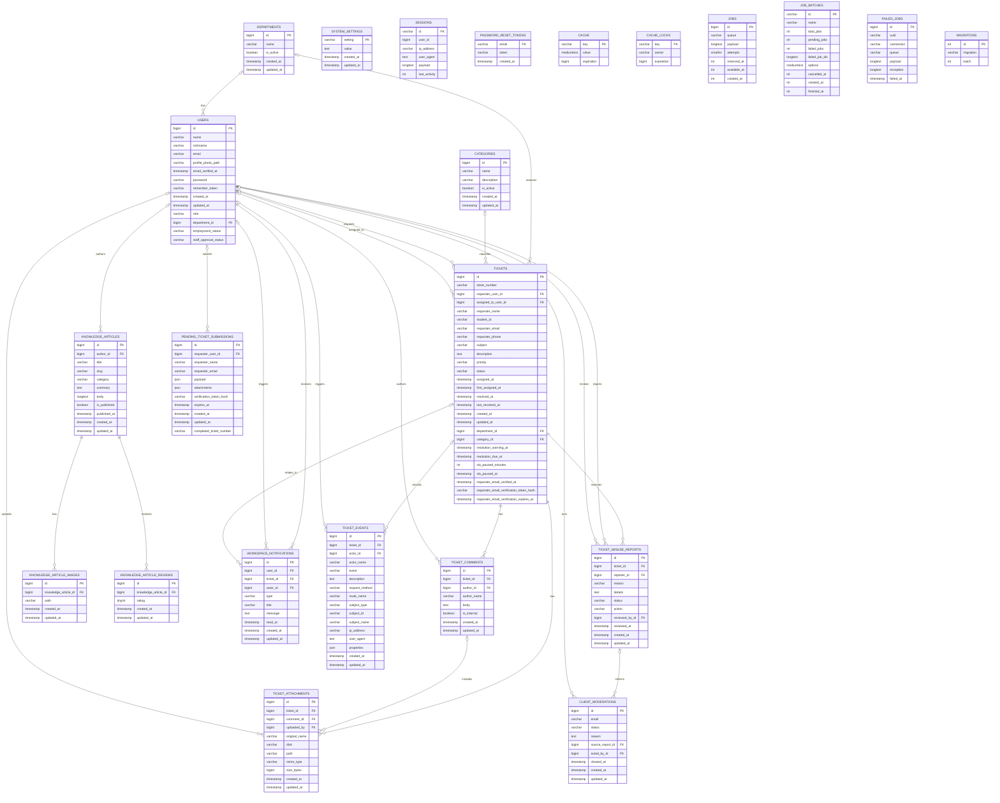
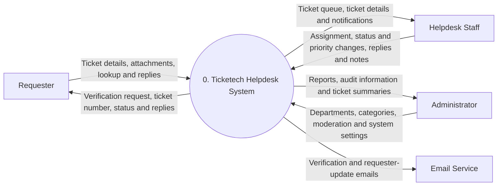
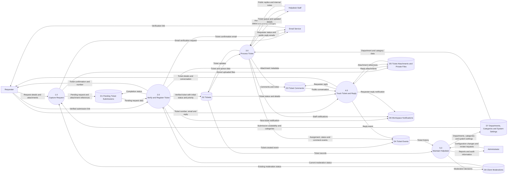

# Ticketech ERD

This ERD lists every column in the 23 Ticketech and Laravel support tables. `PK` marks primary keys and `FK` marks foreign keys. Column types are simplified for readability.

`SESSIONS.user_id` is indexed but is not declared as a foreign key. The remaining support tables do not have foreign-key relationships in the migrations.

## 2.9.2 Process Modeling

The following DFDs show the requester ticket-submission and helpdesk workflow. Mermaid flowchart shapes represent external entities, processes, and data stores; arrows are labeled with the data exchanged.

### Level 0: Context Diagram

The context diagram treats Ticketech as one process. Requesters submit and track tickets, helpdesk staff manage and respond to them, and administrators maintain service configuration and review operational information. Ticketech sends verification and ticket-update emails through the external email service.

### Level 1: Ticket Handling

Process 1 validates a requester-submitted form against the configured service availability and moderation status, stores it as pending with its uploaded files, and sends an email verification request. Process 2 validates the verified submission, rechecks moderation, creates a new ticket, records its initial event and notifications, and returns a ticket number and confirmation.

Process 3 lets authorized helpdesk staff work the ticket: assign or transfer it, update its status or priority, and add public replies or internal notes. The system records changes, notifies workspace users, and emails requester-facing updates. Process 4 lets a requester retrieve a ticket using its ticket number and email, view its public conversation and attachments, and reply while the ticket is open. Process 5 lets administrators maintain departments, categories, service settings, and client moderation records, and review reports and audit information.
